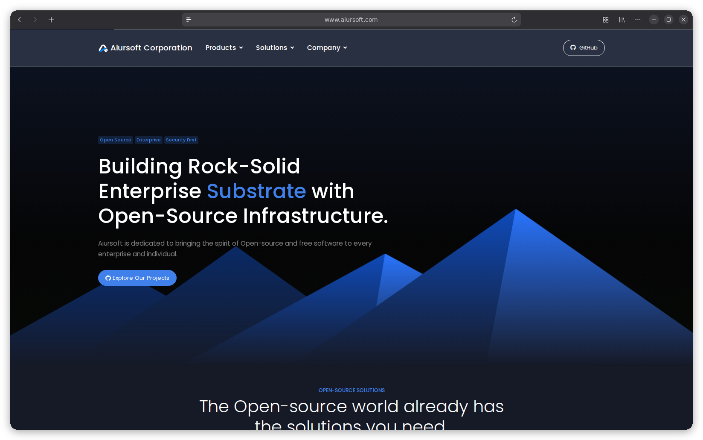

# CorpHome

[](https://github.com/aiursoftweb/corpHome/blob/master/LICENSE)
[](https://gitlab.aiursoft.com/aiursoft/corpHome/-/pipelines)
[](https://gitlab.aiursoft.com/aiursoft/corpHome/-/pipelines)
[](https://s360.aiursoft.com/SupplyChain?tab=projects&project=aiursoft%2Fcorphome&scope=baseline&ecosystem=all)
[](https://manhours.aiursoft.com/r/github.com/aiursoftweb/corpHome.html)
[](https://www.aiursoft.com)
[](https://hub.docker.com/r/aiursoft/corphome)

CorpHome is Aiursoft's official website homepage.



Default user name is `admin@default.com` and default password is `Admin@123456!`.

## Try

Try a running CorpHome [here](https://corpHome.aiursoft.com).

## Install with Docker

Run the installer with the desired port (omit it to choose an available port):

```bash
curl -fsSL https://raw.githubusercontent.com/aiursoftweb/corphome/master/install.sh | sudo bash -s -- 8080
```

Installation starts after three seconds; press Ctrl+C to cancel. Then open `http://localhost:8080`.

## Run manually

Requirements about how to run

1. Install [.NET 10 SDK](http://dot.net/) and [Node.js](https://nodejs.org/).
2. Execute `npm install` at `wwwroot` folder to install the dependencies.
3. Execute `dotnet run` to run the app.
4. Use your browser to view [http://localhost:5000](http://localhost:5000).

## Run in Microsoft Visual Studio

1. Open the `.sln` file in the project path.
2. Press `F5` to run the app.

## Run in Docker

First, install Docker [here](https://docs.docker.com/get-docker/).

Then run the following commands in a Linux shell:

```bash
image=aiursoft/corpHome
appName=corpHome
sudo docker pull $image
sudo docker run -d --name $appName --restart unless-stopped -p 5000:5000 -v /var/www/$appName:/data $image
```

That will start a web server at `http://localhost:5000` and you can test the app.

The docker image has the following context:

| Properties  | Value                           |
|-------------|---------------------------------|
| Image       | aiursoft/corpHome               |
| Ports       | 5000                            |
| Binary path | /app                            |
| Data path   | /data                           |
| Config path | /data/appsettings.json          |

## Contact alerts in AlertCenter

New valid contact submissions are saved with a stable report ID in the same database write as the contact. A background job sends one **sev2** incident per contact, normally within one minute, using `Aiursoft.AlertCenter.SDK`. Contact submissions never wait for AlertCenter. Existing contacts from before this integration have no report ID and are not backfilled.

Configure the following global settings in the administration UI or override them with environment variables:

| Environment variable | Default | Purpose |
|---|---|---|
| `GlobalSettings__AlertCenter_Enabled` | `False` | Enable delivery. Disabling pauses delivery but retains new submissions for later delivery. |
| `GlobalSettings__AlertCenter_Endpoint` | `https://alertcenter.aiursoft.com` | AlertCenter HTTP(S) base URL. |
| `GlobalSettings__AlertCenter_ApiKey` | Empty | Dedicated CorpHome application key with **create incident** permission. Stored as a secret when configured in the UI. |
| `GlobalSettings__AlertCenter_PublicBaseUrl` | `https://www.aiursoft.com` | CorpHome HTTP(S) base URL for authorized contact-list links. |

SQLite and MySQL migrations add nullable report ID and delivery timestamp columns; they are applied at application startup. Failed deliveries remain pending across restarts and are retried by the next job. The same report ID is reused after timeouts or local receipt-save failures, so AlertCenter's application-scoped idempotency prevents duplicate incidents. Keep the same AlertCenter application and its incident history when rotating API keys. The job processes submissions sequentially in pages of 100 and continues with other contacts after an individual failure; failures are visible on the Jobs page and in logs.

Incidents contain only the contact ID, submission time and a link to `/Contacts#contact-{id}`; names, email addresses and inquiry text stay in CorpHome. Responders need CorpHome contact-view permission. Successful notification alone does not mitigate the inquiry. Optional email follow-up detection can mitigate it as described below; CorpHome does not send customer emails.

Before enabling production delivery, create the CorpHome application/key in AlertCenter, configure the sev2 notification route and responder access, and supply `CORPHOME_ALERTCENTER_API_KEY` to the Box deployment. Deploy CorpHome before applying the Box configuration. Verify a valid test submission produces exactly one incident and reaches the intended channel; invalid submissions must not produce incidents. Do not use a production endpoint or key for automated tests.

### Automatic mitigation after staff email follow-up

This optional integration uses standard IMAPS (MailKit), not a Mailcow-specific API. Configure it in the administration settings UI or with the following environment variables. It requires AlertCenter integration to be enabled and its application key to have **query** and **mitigate** permissions as well as **create** permission.

| Environment variable | Default | Purpose |
|---|---|---|
| `GlobalSettings__ContactMail_Enabled` | `False` | Enable mailbox polling and automatic mitigation. |
| `GlobalSettings__ContactMail_Host` | Empty | IMAP hostname, without a URL scheme. |
| `GlobalSettings__ContactMail_Port` | `993` | Implicit TLS port; valid server certificates are required. |
| `GlobalSettings__ContactMail_Username` | Empty | Dedicated follow-up mailbox username. |
| `GlobalSettings__ContactMail_Password` | Empty | Mailbox/application password; stored encrypted when set in the UI. |
| `GlobalSettings__ContactMail_Folder` | `INBOX` | Folder receiving staff follow-up copies. |
| `GlobalSettings__ContactMail_StaffSenders` | Empty | Comma-separated exact email addresses or `@domains`; case-insensitive, no implicit subdomains. |
| `GlobalSettings__ContactMail_FollowUpDays` | `7` | Follow-up window, from 1 to 30 days. |

Provision a dedicated mailbox receiving copies of employee replies, either by adding it to your staff CC group or by asking staff to CC it directly. **The mail server must restrict delivery into this monitored folder to authenticated internal employees, including indirect delivery through aliases and direct delivery to the mailbox.** The configured sender allowlist is a filter, not proof of sender identity. Do not enable polling on an unrestricted inbox or rely on a `From` domain alone. Verify that an external message impersonating an employee cannot enter the monitored folder before enabling production mitigation. No mail server administrator credentials are needed by CorpHome.

Every minute the job reads envelope fields, the delivery timestamp and the `Auto-Submitted` header. It never downloads message bodies, marks messages as read, moves or deletes messages. A non-automatic email must have exactly one allowed From address, and any Sender addresses must also be allowed. A customer must appear in To or CC (BCC is not inspected). Both the sent and mailbox delivery times must be after the inquiry; future-dated messages are ignored. One email mitigates all matching submissions made in the configured window before it was sent. Email comparison ignores case and surrounding whitespace, but does not merge plus-addresses or different aliases. Later inquiries require another employee email. Staff addresses in the allowlist are excluded from customer matching.

The job persists its mailbox identity, UIDVALIDITY and last processed UID with follow-up evidence in the same database save. It reads at most 1000 message envelopes per run in batches of 100, sequentially, with a two-minute mailbox timeout; remaining messages continue next run. First connection, mailbox identity changes and UIDVALIDITY resets scan recent history within the configured number of days (plus one calendar day for IMAP timezone boundaries). Keep relevant messages in the monitored folder until processed. Changing the sender filter or window does not replay already processed UIDs. Emails older than the polling lookback are not recovered after a prolonged outage.

Follow-up evidence is retained even if incident creation has not finished. Incident IDs are saved with creation receipts; previously reported contacts missing an incident ID recover it by resending the same application-scoped ReportId. Mailbox outages do not block mitigation of previously saved evidence. Failed receipt saves or mitigation calls retry next run. The SDK reads the current incident version before mitigation; already mitigated or resolved incidents are treated as complete, and version conflicts are retried after a fresh read. This integration **mitigates**, rather than resolves, incidents and does not reopen them. AlertCenter may subsequently resolve them according to its own policy. Customer addresses and email contents are never added to incident mitigation reasons.

Before rollout, apply both database migrations, configure and test the restricted mailbox, grant API permissions, then enable polling. Test against an isolated mailbox and AlertCenter application first: submit twice for one customer, send one staff reply copied to the monitored mailbox and confirm both incidents mitigate; a later submission, an external sender and an automatic response must not mitigate. Production mailbox provisioning, credentials and a real delivery test are deployment prerequisites.

## How to contribute

There are many ways to contribute to the project: logging bugs, submitting pull requests, reporting issues, and creating suggestions.

Even if you with push rights on the repository, you should create a personal fork and create feature branches there when you need them. This keeps the main repository clean and your workflow cruft out of sight.

We're also interested in your feedback on the future of this project. You can submit a suggestion or feature request through the issue tracker. To make this process more effective, we're asking that these include more information to help define them more clearly.
